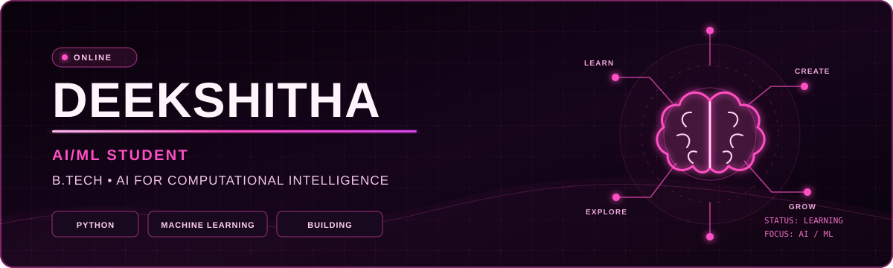

 

<h3>Learning to build intelligence, one model at a time.</h3>

---

## 💗 01 // THE MIND

Hey, I'm **Deekshitha** — a B.Tech student specializing in **AI for Computational Intelligence**.

I'm working toward becoming an **AI/ML Engineer**. I'm fascinated by how code, data, and mathematics come together to make intelligent systems possible.

Right now, I'm building my foundations: learning deeply, practicing consistently, and turning concepts into projects.

- 🎓 AI for Computational Intelligence
- 🧠 Interested in machine learning and intelligent systems
- 🐍 Building programming foundations with Python
- 🧩 Practicing DSA and problem-solving
- 🌱 Exploring open source and learning how real projects work

---

## 💗 02 // THE LEARNING CURVE

| AI & Intelligence | Engineering | Foundations |
|:---:|:---:|:---:|
| Machine learning basics | Python & C | Mathematics for AI |
| Data science concepts | DSA practice | Git & GitHub |
| Computational intelligence | Debugging & building | Learning in public |

---

## 💗 03 // THE LAB

### 🧠 MINDVAULT

**A coding-learning companion concept I'm exploring**

I want to create a space that captures more than a solved problem: the question, my approach, the errors I encountered, and the patterns I should revisit.

- Track coding questions, solutions, and errors.
- Understand recurring mistakes.
- Visualize problem-solving patterns.
- Improve through reflection and practice.

*Currently exploring and building.*

---

## 💗 04 // THE COMMIT CURVE

---

## 💗 05 // THE DIRECTION

- Become a skilled AI/ML Engineer.
- Strengthen Python and DSA fundamentals.
- Build meaningful projects.
- Contribute to open-source.
- Keep learning beyond the classroom.

---

 

Curiosity, compiled — one commit at a time.

