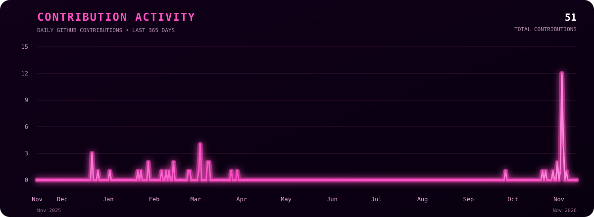

 

<h3>Learning to build intelligence, one model at a time.</h3>

  
  
  

---

## 💗 01 // THE MIND

Hey, I'm **Deekshitha** — a B.Tech student specializing in **AI for Computational Intelligence**.

I'm working toward becoming an **AI/ML Engineer** with strong software engineering foundations. I'm fascinated by how code, data, mathematics, and engineering come together to build intelligent systems.

Right now, I'm focused on learning deeply, building consistently, solving problems, and contributing to real-world projects.

- 🎓 AI for Computational Intelligence
- 🧠 Interested in machine learning and intelligent systems
- 💻 Exploring software engineering and full-stack development
- 🐍 Building programming foundations with Python
- 🧩 Practicing DSA and problem-solving
- 🌱 Exploring open source and collaborative development

---

## 💗 02 // THE LEARNING CURVE

| AI & Intelligence | Software Engineering | Foundations |
|:---:|:---:|:---:|
| Machine Learning | Frontend Development | Mathematics for AI |
| Data Science | Backend Development | Data Structures |
| Computational Intelligence | Databases & APIs | Algorithms |
| AI-powered Applications | Git & GitHub | Problem Solving |

### TECHNOLOGY STACK

---

## 💗 03 // THE LAB

### 🧠 MINDVAULT

**An AI-powered coding-learning companion concept.**

I want to build a platform that remembers how I solve problems, not just whether I solve them.

The idea is to capture questions, approaches, solutions, mistakes, and recurring patterns to help improve problem-solving over time.

- Track coding questions, solutions, and errors.
- Identify recurring mistakes.
- Visualize problem-solving patterns through an error map.
- Reflect on progress and improve through practice.

*Currently exploring and building.*

---

## 💗 04 // THE COMMIT CURVE

### A YEAR OF BUILDING, LEARNING & CONTRIBUTING

 

 
 

Move your cursor across the interactive graph to explore daily contributions.

---

## 💗 05 // THE DIRECTION

- Become a skilled AI/ML Engineer.
- Build strong software engineering fundamentals.
- Strengthen Python, DSA, and problem-solving.
- Explore machine learning and intelligent systems.
- Build meaningful full-stack and AI-powered projects.
- Contribute to open-source communities.
- Learn by building, experimenting, and collaborating.

---

## 💗 06 // CONNECT

---

 
 

Curiosity, compiled — one commit at a time.

